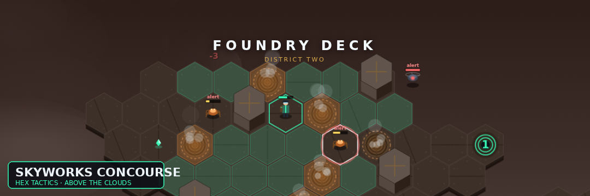

# Skyworks Concourse

A hex-grid, turn-based tactics game set on a retro-futuristic cargo concourse above the clouds. You are a courier carrying the micro-core that the dark Skyworks beacon needs. Fight your way across three districts of drifting platforms, gather the lens, bearing and star-chart, and climb the Beacon Spire to light it.

Play it at **https://eoinfitzsimons.github.io/Skyworks-Concourse/**



## Features

- **Hex board on canvas.** Pointy-top hexes drawn entirely in code: deck plating, catwalks, open sky (impassable), cargo cover (blocks movement and line of sight), steam vents (cost 2 and scald on odd rounds), lift pads and quest markers.
- **Four hand-designed maps.** Harbour Ring, Foundry Deck, Observatory Gardens and the Beacon Spire finale.
- **Initiative turn order.** Every round the courier and the enemies act in initiative order, shown in the turn bar above the board. Enemies move visibly, hex by hex.
- **Five enemy types with their own behaviour.** Drones patrol and swarm, scuttlers lurk in cover and flee when hurt, turrets hold position and fire at range, skimmers hit and run, and the Beacon Warden guards the summit and charges a heavy blast.
- **Quest objectives.** Deliver items, reach hexes, defeat groups and hold a position for three turns.
- **Shards and upgrades.** Collect shards on the board and from fallen enemies; spend them between districts on hull plating, leg servos, a reflex coil, a sharper blade, the Overclock module or repair kits.
- **Abilities.** Arc Blade (adjacent), Arc Bolt (three hexes with line of sight, recharges), Repair Kit (item) and Overclock (extra move and action, once bought).
- **Polish.** Title screen with intro and continue, pause, autosave to localStorage, synthesised ambience and effect cues with a mute toggle, hex minimap, keyboard shortcuts and a how-to-play panel.

## Controls

| Input | Action |
| --- | --- |
| Mouse hover | Show hex coordinates, tile, movement cost and attack range |
| Click a highlighted hex | Move along the previewed path |
| Click an adjacent enemy | Arc Blade strike |
| Click an enemy within three hexes | Arc Bolt (if charged) |
| `1` – `4` | Select Arc Blade, Arc Bolt, Repair Kit, Overclock |
| `Enter` / `Space` | End turn |
| `Esc` | Cancel targeting, or pause / resume |
| `H` | How to play |
| `M` | Mute / unmute |
| `N` | Toggle minimap |
| `Q` | Toggle the quest log |

The site is static: `index.html`, `css/style.css` and `js/*.js`. No build step, frameworks, image or audio assets.

## Running locally

```sh
python3 -m http.server 8000
```

Then open http://localhost:8000/. The game exposes its state as `window.__game` for inspection in the console.

## Files

- `index.html` – markup for the HUD, overlays and script includes
- `css/style.css` – layout and overlay styling
- `js/hex.js` – axial hex maths, Dijkstra reachability and A* pathfinding
- `js/data.js` – tiles, units, abilities, shop items and the four maps
- `js/audio.js` – Web Audio ambience and effect cues
- `js/render.js` – procedural canvas renderer, minimap and portraits
- `js/game.js` – turn order, player actions, enemy AI, quests, shop, save/load and UI
